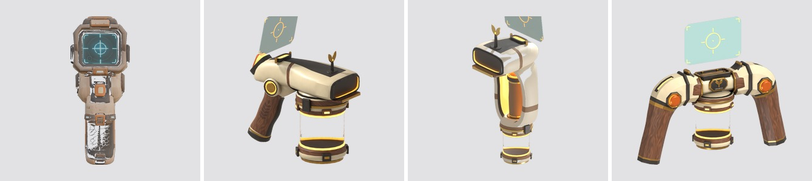

# FLORA: images for the Devpost description

Screenshots and GIFs of FLORA (Field Lab for Other-Realm Affairs), captured from the game.

## Scanner iterations

The scanner went through many versions before it felt right in the hand. From left to right:

1. **First concept (Oct 30-31).** An AI-generated scanner from Tripo, cleaned up and made symmetrical. It set the look, but it was never built for hand tracking.
2. **One-handed with a thumb key (Nov 14).** Rebuilt procedurally, with the seed jar underneath. The earlier index-finger trigger was hidden from the headset's hand tracking in this grip, so the trigger moved to a key under the thumb.
3. **One-handed hoop grip (Nov 15).** One of several one-handed explorations (a grip bar, a hose, a hoop) looking for a hold that tracks reliably.
4. **Two-handed final design (Nov 15).** A gamepad-like layout held with both hands, with a projected holographic screen, a scan aperture at the back and the jar docked below. This is the scanner in the game today.

In the end the one-handed versions were explored through eight shapes and the two-handed one through fifteen before the final model.
